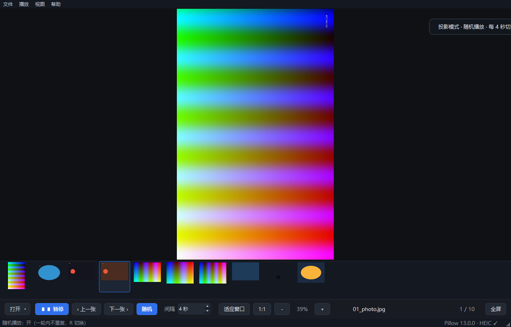
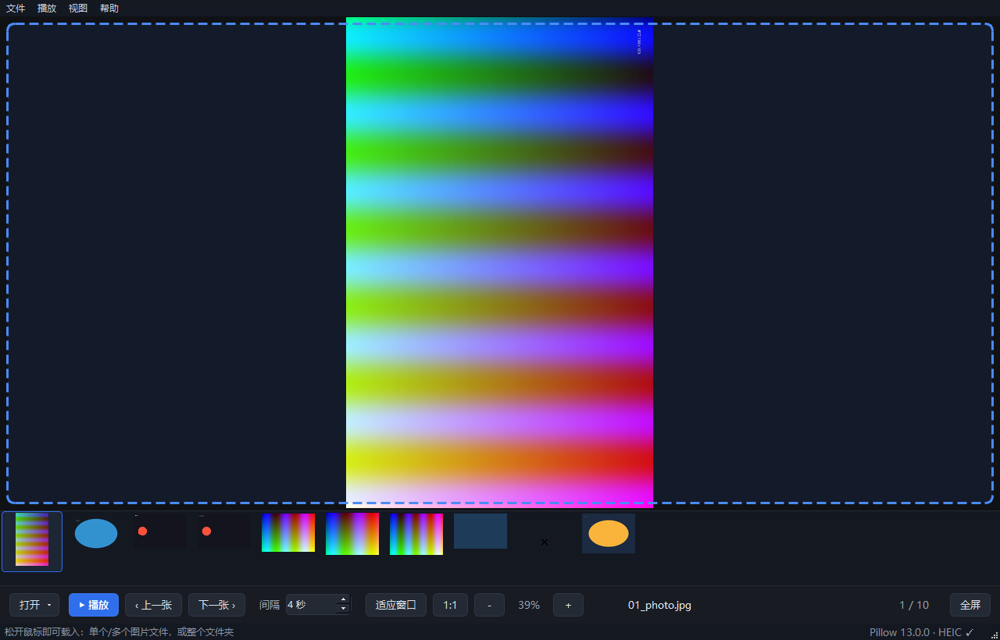

# 光影相册 · Image Viewer

一个本地图片查看器 + 幻灯片播放器，交互对齐 Windows「照片」：自动切换、间隔可调、播放/暂停、上一张/下一张、单张缩放平移，并支持**真全屏投影**、**随机播放**、**Del 直接把图删到回收站**，以及**按 `Enter` 一键投影（全屏 + 随机 + 自动播放）**。

技术栈：**PySide6（Qt 6）** 负责界面与渲染，**Pillow + pillow-heif** 负责解码。

> **直接下载可执行程序 →** [Releases · ImageViewer-v1.0.0.exe (58 MB)](https://github.com/314662376/image-viewer/releases/download/v1.0.0/ImageViewer-v1.0.0.exe)
> 单文件，Windows 10/11 x64 双击即用，目标机无需 Python 与任何依赖。仓库内只存源码与素材，58 MB 的 exe 放在 Release 附件里，避免每次提交都把二进制叠进 git 历史。



---

## 1. 运行方式

**方式 A · 直接跑 exe（给别人的电脑用这个）**

从 [Releases](https://github.com/314662376/image-viewer/releases) 下载 `ImageViewer-v1.0.0.exe`（即本地的「光影相册.exe」，同一份构建），双击即可。**单文件，不需要装 Python、不需要任何依赖**，Windows 10/11 64 位开箱即用（详见第 6 节）。

**方式 B · 源码运行**

```bat
run.bat                      :: 使用本目录已就绪的 .venv
:: 或
pip install -r requirements.txt
python image_viewer.py
```

---

## 2. 打开图片：三种入口，一套逻辑

| 入口 | 操作 |
|---|---|
| **拖拽** | 把图片文件、多个文件，或者**整个文件夹**直接拖进窗口；拖入时画布出现蓝色虚线高亮框，松手即载入 |
| **菜单 / 工具栏** | 「文件 → 选择文件夹…」`Ctrl+Shift+O` 走系统文件夹对话框；「打开图片…」`Ctrl+O`；工具栏「打开 ▾」下拉出这两项 |
| **命令行** | `python image_viewer.py D:\photos`（传文件则载入其所在目录并定位到该文件） |

三种方式最终都进同一个函数 `open_source()`，扫描、校验、提示逻辑完全共用，不会出现"拖拽能开、菜单打不开"的差异。



### 行为约定

| 拖入 / 选中的内容 | 结果 |
|---|---|
| 一个文件夹 | 扫描其中所有受支持的图片，按文件名自然排序（`img2 < img10`）后整目录载入 |
| 多个文件夹 | 载入第一个，浮层提示"其余 N 个文件夹未处理" |
| 单个 / 多个图片文件 | 载入第一个图片所在目录，并**定位到该文件**；跨目录的多张只载入第一个所在目录并提示 |
| 图片 + 不支持的文件混拖 | 正常载入图片，浮层提示"已跳过 N 个不支持的文件" |
| 全是不支持的文件 | **弹框**：列出文件名 + 当前支持的全部格式 |
| 空文件夹 | **弹框**：说明没有受支持图片，并提示可开启「包含子文件夹」 |
| 根目录没图、子目录有图 | **弹框询问**是否连同子文件夹一起载入；选"是"会自动勾上「文件 → 包含子文件夹」并载入 |
| 路径不存在 / 已删除 | **弹框**列出不存在的路径 |

### 子文件夹开关

「文件 → 包含子文件夹」`Ctrl+R` 是**全局开关，拖拽与菜单选择共用**，默认关闭（与 Windows 照片一致，只看当前目录）。开启后按相对路径自然排序（`第1天\a.jpg` 排在 `第2天\a.jpg` 之前）。

---

## 3. 支持格式与处理方式

所有格式统一走「Pillow 解码 → RGBA → QImage → QPixmap」一条管线，靠**文件头嗅探**判断真实格式，不依赖扩展名（所以 `.jfif`、无扩展名文件都能开）。

| 格式 | 解码器 | 处理要点 |
|---|---|---|
| jpg / jpeg / jpe / **jfif** / pjpeg | Pillow（libjpeg-turbo） | JFIF 只是 JPEG 的容器写法，同一解码器；解码前用 `draft()` 直接降采样，超大照片不占内存 |
| png / apng | Pillow（zlib） | 保留 Alpha 透明通道；APNG 按多帧播放 |
| **webp** | Pillow（libwebp） | 静态 + 动态 WebP 都支持，按帧时长播放 |
| **gif** | Pillow | 逐帧 `seek()`，Pillow 已完成帧合成与 disposal 处理，透明正确 |
| bmp / dib / tif / tiff / ico | Pillow | TIFF 多页取首帧 |
| **heic / heif / avif** | pillow-heif（libheif，wheel 自带 dll） | Windows 无需安装系统级 HEIC 扩展；未装库时界面明确提示而不是静默失败 |

额外的显示层处理：

- **EXIF 方向**：`ImageOps.exif_transpose()` 自动旋正竖拍照片。
- **色彩管理**：带 ICC 配置的图片（AdobeRGB、Display P3 等）先转 sRGB 再显示，避免偏色。
- **尺寸上限**：静态图最长边 4096、动图 1600，超出等比缩小；动图另有 4000 万像素总量预算（约 160MB），过量自动截断帧数。
- **帧时长**：读取每帧 `duration`，缺失时兜底 80ms，最小 20ms。

---

## 4. 操作

| 操作 | 快捷键 |
|---|---|
| 播放 / 暂停（切换） | `空格` |
| 上一张 / 下一张 | `←` / `→` |
| 第一张 / 最后一张 | `Home` / `End` |
| **放大 / 缩小（自动暂停）** | `↑` / `↓` |
| 适应窗口 / 原始大小 | `0` / `1` |
| 缩放（滚轮以光标为中心） | `+` `-` 或鼠标滚轮 |
| 适应窗口 ⇄ 100% | 双击画面 |
| 放大后平移 | 按住左键拖动 |
| **一键投影（全屏 + 随机 + 播放）** | `Enter` |
| **全屏投影 / 退出** | `F11` / `Esc` |
| 全屏中临时唤出控制条 | `H` |
| **随机播放开关** | `R` |
| **删除当前图片到回收站** | `Del` / `Backspace` |
| 显示隐藏缩略图 / 控制条 | `T` / `H` |
| 打开图片 / 选择文件夹 | `Ctrl+O` / `Ctrl+Shift+O` |
| 包含子文件夹 | `Ctrl+R` |
| 格式与快捷键说明 | `F1` |

切换间隔在底部「间隔」框里调，1–120 秒，播放中改动立即生效。幻灯片循环播放。

控制条上只有一个**播放/暂停切换按钮**：暂停时显示「▶ 播放」，播放中显示「❚❚ 暂停」，点击即在两个状态之间切换。它、空格键、「播放」菜单项三者都调同一个 `toggle_play()`，行为完全一致——不存在"按钮显示状态"和"实际是否在播"对不上的情况。播放状态只有 `set_playing()` 一个写入口，按钮文字、按钮 tooltip、菜单项文案、状态栏提示都在那里统一刷新。

### 一键投影：`Enter`

按 `Enter` 一步到位，比 `F11` 多两件事，适合投屏/给客人看照片：

1. **开随机播放**（图片多于 1 张时）——一轮内不重复
2. **自动开始播放**（原本是暂停态也会起播）

三者顺序固定：先开随机（随机池以当前这张为「已放」，不会立刻重复）→ 再进全屏 → 最后起播，收尾只留一条浮层提示 `投影模式 · 随机播放 · 每 N 秒切换 · Esc / Enter 退出 · 空格暂停`。

已在全屏时再按一次 `Enter` 退出全屏，**播放和随机状态都保留**（与 `Esc` 等价）。`F11` 仍是纯全屏，不改变播放/随机状态；没有图片时按 `Enter` 会提示先打开文件夹，不会进入全屏。

### 全屏投影（真全屏）

按 `F11`、`Enter` 或点「全屏」，**菜单栏、缩略图条、控制条、状态栏全部隐藏**，画面铺满整块屏幕；播放中连鼠标指针也会自动隐藏，鼠标一动立即恢复。`Esc` 或 `F11` 退出后，窗口恢复进全屏前的状态（原先是最大化就回到最大化，缩略图/控制条的显隐也照旧）。

全屏里按 `H` 可以临时唤出控制条（改间隔、切随机用），再按一次收起——状态栏和缩略图在全屏下一律不出现。

### 随机播放

点控制条「随机」按钮、按 `R`、或「播放 → 随机播放」勾选，三者同步同一个 `_shuffle` 状态。

不是每次 `randrange` 抽一张——那样会连播同一张、有的图永远轮不到。实现是**"本轮已放"集合洗牌**：一轮之内每张恰好出现一次，全部放完自动开新一轮（新一轮里也不会立刻重复上一张）。随机只影响"往后翻"（自动切换与「下一张」），`←` 上一张仍是顺序回退，方便回看；点缩略图跳转不受影响。换文件夹或删图后集合同步重置/前移。

### 删除到回收站

播放中（或暂停时）按 `Del`，当前图片**移到回收站**，可以随时在资源管理器里还原，不是物理删除。实现走 Windows shell 的 `SHFileOperationW` + `FOF_ALLOWUNDO`，返回码、是否被中止、文件是否真的消失三重校验，失败会弹框写清原因（被占用 / 路径过长 / 系统错误码）。

删除后：列表与缩略图条同步移除该项、随机池索引整体前移、画面直接跳到下一张，**播放不中断**（定时器重新计时）；删到目录为空时显示占位提示并自动停播。

### 缩放规则

- **范围 5% ~ 1600%**（相对原图像素，`1:1` = 100%）。到顶/到底时再缩放不会动，状态栏提示「已到最大放大倍数 1600%」。
- **滚轮**：以鼠标指针所在位置为锚点放大缩小，指针下的那块内容保持不动（实测漂移 < 0.2px）。
- **`↑` / `↓`**：以画布中心为锚点，每次 ×1.25 / ÷1.25，等价于 `+` / `-` 和「＋」「－」按钮。
- **任何主动缩放都会自动暂停幻灯片**——手动接管画面时再自动跳下一张会突然换图，所以滚轮、`↑↓`、`＋－` 按钮、`+ -` 快捷键一律顺手暂停，状态栏会写明「已暂停（手动缩放）」。本来就没在播放时不会误报。
- 换图（自动或手动翻页）后缩放重置为「适应窗口」，翻着看不会带着上一张的放大倍数乱跳。


---

## 5. 实现要点

- **单一打开入口**：`open_source()` 统一做分类（文件夹 / 图片 / 其它）、存在性校验和提示分发；`dropEvent`、`choose_folder`、启动参数都只调它一次，保证三条路径行为一致。
- **拖放事件冒泡**：画布与缩略图条显式 `setAcceptDrops(False)`，拖放事件必然冒泡到主窗口，避免光标落在缩略图上时拖拽"失灵"。
- **覆盖层提示**：拖拽高亮框与浮层 toast 都是子控件绝对定位 + `WA_TransparentForMouseEvents`，不参与布局，也不打断拖拽事件链。
- **阻断 vs 非阻断提示**：开不了图（空目录 / 全不支持 / 路径不存在）用 `QMessageBox` 说清楚；只是"跳过几个文件"用画布浮层 toast，不打断操作。
- **解码不阻塞 UI**：图片在 `QThreadPool` 子线程解码成 `QImage`（QPixmap 只在主线程建），每次切图自增 token，回来的结果对不上就丢弃，快速连按方向键不会串图。
- **缩放/平移**：`QGraphicsView` + `fitInView`，`ScrollHandDrag` 拖动画布。锚点缩放没用 Qt 的 `AnchorUnderMouse`——它内部依赖 `QGraphicsViewPrivate::lastMouseEvent`（只在真实鼠标移动时刷新，滚轮事件不更新它），实测会退回"以中心缩放"、指针处漂移 20px 以上；改成在 `zoom_by()` 里先记下锚点对应的场景坐标，缩放后用滚动条把它拉回锚点位置，精度可验证到 0.2px 内。
- **动图**：不用 `QMovie`（只认 gif/webp），自写 `QTimer` 按帧时长推进，gif / 动态 webp / apng 共用一套逻辑。
- **缩略图条**：后台线程生成、按需回填，`generation` 计数防止切换文件夹后旧缩略图错位；每个 item 额外存一份文件路径，异步结果回来时再核对一次——删图会让行号整体前移，只靠 generation + row 会把图贴到错的行上。
- **界面显隐单一出口**：菜单栏/缩略图条/控制条/状态栏的显示与否全部由 `_apply_chrome()` 决定，各处只改布尔标志再调它，避免"全屏里有人又把缩略图点亮了"这类互相打架。
- **删除走 shell**：`SHFileOperationW` 的 `pFrom` 必须以双 `\0` 结尾表示列表结束；结构体里 `fFlags` 是 `WORD`（`c_uint16`），写成 `c_uint` 会让后面的字段错位、调用直接失败。

---

## 6. 打包成单文件 exe

已打包好的成品就在本目录：**`光影相册.exe`（57 MB，单文件）**。拷到任何 Windows 10/11 x64 电脑上双击即可运行，目标机不需要 Python、不需要 pip、不需要 HEIC 扩展、不需要 VC++ 运行库。

打包内容（已内嵌进 exe）：Python 运行时 + PySide6（含 `qwindows` 平台插件、`qjpeg`/`qgif`/`qwebp` 图像插件）+ Pillow + pillow-heif（libheif/libde265/libx265 全部 dll）+ MSVC 运行库（`MSVCP140`/`VCRUNTIME140`）。

### 重新打包

```bat
build.bat
```

等价命令：

```bat
.venv\Scripts\python -m PyInstaller --noconfirm --clean --onefile --windowed ^
  --name ImageViewer --icon icon.ico --add-data "icon.ico;." ^
  --collect-all pillow_heif image_viewer.py
```

两个参数不能省：

- `--onefile`：打成单文件，启动时自解压到临时目录；代价是首次启动约 2–4 秒（之后系统缓存会快一些）。
- `--collect-all pillow_heif`：**必须加**，否则 libheif 的 dll 不会被收进去，HEIC 会打不开。

### 换机器后先自检

```bat
光影相册.exe --selftest D:\photos
```

会把目标目录里的图片全部解码一遍，并顺手建一次窗口、截一张图，报告写到 `%TEMP%\image_viewer_selftest.txt`（截图 `%TEMP%\image_viewer_selftest.png`）。在陌生电脑上想确认"到底能不能用"，跑这条最快——报告里会写清 PySide6 / Pillow / pillow-heif 版本、HEIC 是否可用、每个文件解出多少帧、GUI 是否正常。

### 两个提醒

- 未做代码签名，首次运行 Windows SmartScreen 可能提示"未知发布者"，点「更多信息 → 仍要运行」即可。
- 单文件 exe 每次启动都会解压到 `%TEMP%\_MEIxxxx`，正常退出会自动清理；若被强杀可能留下临时目录，可手动删除。

---

## 7. 已知限制

- 只解码**首帧**的格式：TIFF 多页、ICO 多尺寸。需要多页 TIFF 可扩展 `decode_image`。
- 不支持 RAW（CR2/NEF/ARW）与 PSD。
- 一次只能载入一个文件夹（多个文件夹拖入时取第一个并提示），不支持把多个目录合并成一个播放列表。
- 超大文件夹（>1500 张）只生成前 1500 张缩略图，其余显示占位符，点击仍可正常查看。
- 缩放下限 5%，上限 1600%，超出则钳制并提示；1:1 之外不做插值算法选择（统一 `SmoothTransformation` 平滑缩放）。
- 焦点在「间隔」框里时 `↑`/`↓` 归输入框微调数值（用 `ShortcutOverride` 让位），其余位置都是缩放。
- 暂停状态不跨次启动保存：每次打开程序都是暂停态，需手动开始播放。
- 删除**没有二次确认**（对齐 Windows 照片）：按 `Del` 立即进回收站。因为走的是回收站而不是物理删除，还能还原；但仍请注意别在回收站清空后再去找图。
- 删除只处理本地磁盘文件；网络路径、只读介质、超过 259 字符的长路径会被系统拒绝并弹框提示。
- 全屏是单屏全屏，未做多显示器指定屏幕投影。
